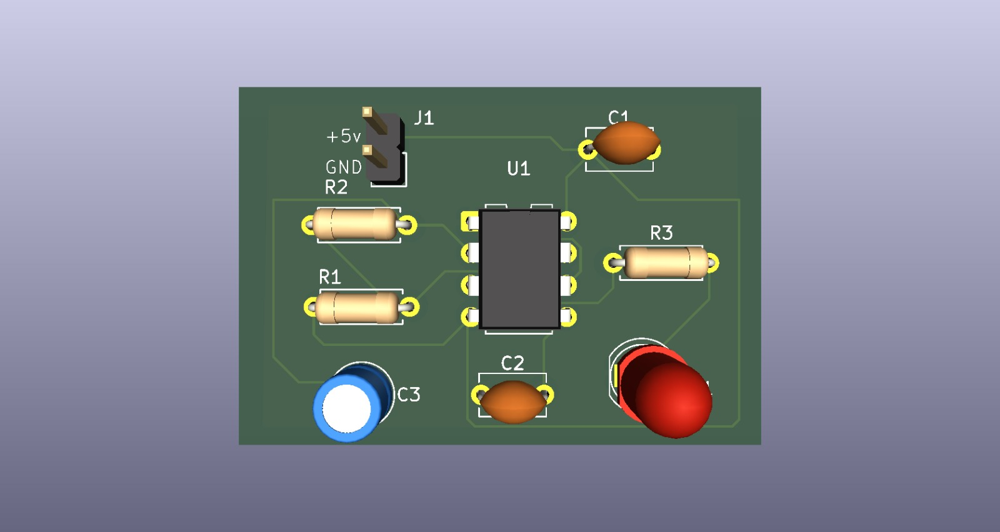
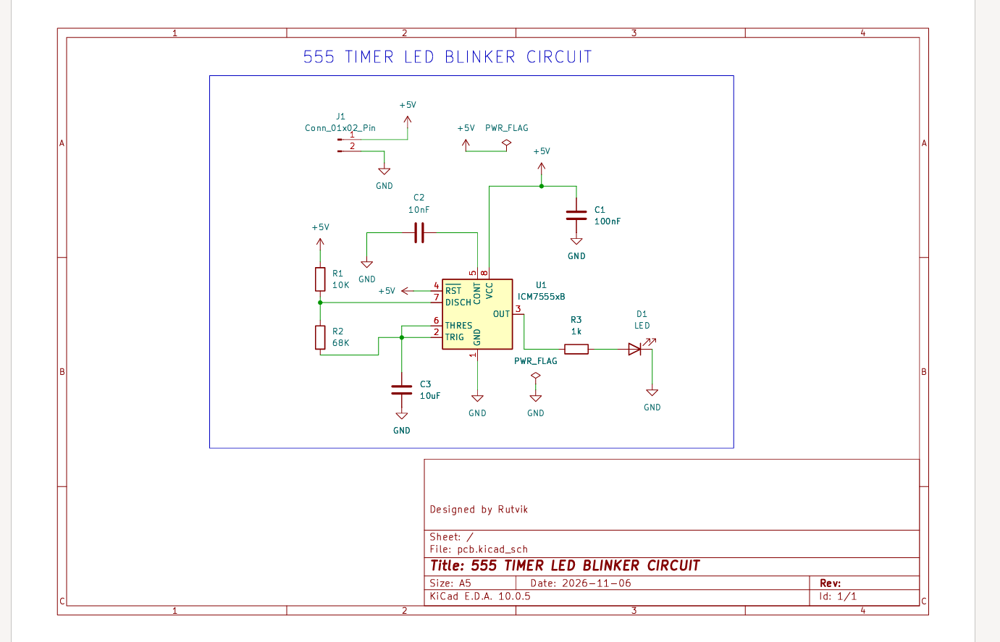
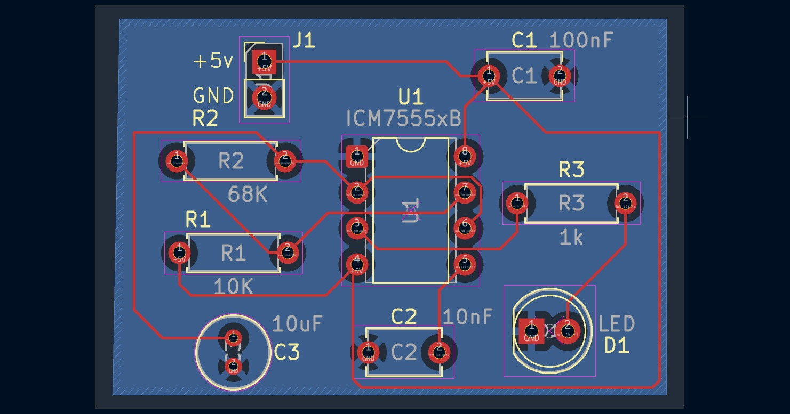

# 555 Timer LED Blinker PCB

A **5 V LED blinker** designed in **KiCad 10**, using an **ICM7555 CMOS 555-family timer** in astable mode. The LED is designed to repeat one complete ON/OFF cycle approximately every **1.01 seconds** while power is connected.

The repository includes the schematic, routed PCB layout, 3D preview, Gerber layers and drill files.

## 3D Preview

## Component Values

| Reference | Value / component | Function |
|---|---|---|
| U1 | ICM7555; schematic value `ICM7555xB` | CMOS timer configured as an astable oscillator |
| R1 | 10 kΩ | Timing resistor between +5 V and discharge pin 7 |
| R2 | 68 kΩ | Timing resistor between pin 7 and the timing-capacitor node |
| R3 | 1 kΩ | LED current-limiting resistor |
| C1 | 100 nF | Supply decoupling between +5 V and GND |
| C2 | 10 nF | Control-pin filtering from pin 5 to GND |
| C3 | 10 µF | Timing capacitor connected to pins 2 and 6 |
| D1 | LED | Visual blink indication |
| J1 | Two-pin connector | Pin 1: +5 V; pin 2: GND |

**R1, R2 and C3 determine the blink timing.** C1 and C2 provide supply/control filtering.

## How It Works

The timer runs continuously in astable mode, without a microcontroller or firmware.

1. C3 charges through **R1 + R2**. The output at pin 3 is HIGH, so current flows through R3 and D1 and the LED turns ON.
2. When C3 reaches approximately **2/3 of the supply voltage**, the output goes LOW and the internal discharge transistor turns on.
3. C3 discharges through **R2**, with the LED OFF.
4. When C3 falls to approximately **1/3 of the supply voltage**, the output goes HIGH again and the cycle repeats.

At a 5 V supply, the nominal capacitor switching levels are approximately **1.67 V** and **3.33 V**. Reset pin 4 is tied HIGH to enable normal operation.

## Calculated Blink Timing

These are **nominal steady-state calculations**, using R1 = 10,000 Ω, R2 = 68,000 Ω and C3 = 0.000010 F.

### LED ON time

`t_ON = ln(2) × (R1 + R2) × C3`

`t_ON ≈ 0.693 × (10,000 + 68,000) × 0.000010 ≈ 0.541 s`

### LED OFF time

`t_OFF = ln(2) × R2 × C3`

`t_OFF ≈ 0.693 × 68,000 × 0.000010 ≈ 0.471 s`

### Period, frequency and duty cycle

`T = t_ON + t_OFF ≈ 1.012 s`

`f = 1 / T ≈ 0.988 Hz`

`Duty cycle = t_ON / T × 100 ≈ 53.4%`

| Parameter | Calculated value |
|---|---:|
| LED ON time | 0.541 s / 541 ms |
| LED OFF time | 0.471 s / 471 ms |
| Complete blink period | 1.012 s |
| Blink frequency | 0.988 Hz, approximately 1 blink per second |
| ON duty cycle | 53.4% |

The repeating pattern is approximately **ON for 0.54 s → OFF for 0.47 s → repeat**. There is no fixed total blinking duration; the oscillator continues while the 5 V supply is applied.

**Startup:** With C3 initially discharged and an ideal sudden application of power, the first ON interval is calculated as `ln(3) × (R1 + R2) × C3 ≈ 0.857 s`. Later cycles follow the steady-state values above. Startup depends on the initial capacitor voltage and supply rise.

Actual timing will vary with resistor/capacitor tolerances, capacitor leakage and timer characteristics. The values above are calculated estimates, not measured hardware results.

Increasing C3 increases both ON and OFF times proportionally. R1 primarily sets the charging interval; R2 contributes to both charging and discharging intervals.

Timing reference: [Renesas ICM7555/ICM7556 datasheet, Figure 5 and Equations 2–3](https://www.renesas.com/en/document/dst/icm7555-icm7556-datasheet).

## Schematic

## PCB Layout

## Repository Files

| File / folder | Contents |
|---|---|
| `pcb.kicad_pro` | KiCad project settings |
| `pcb.kicad_sch` | Circuit schematic |
| `pcb.kicad_pcb` | PCB layout |
| `images/` | Schematic, PCB and 3D screenshots |
| `gerbers/555_Timer_Gerber/` | Copper, solder-mask, silkscreen and board-outline Gerbers; plated/non-plated drill files |

## Opening the Project

Download or clone this repository and open **`pcb.kicad_pro`** using **KiCad 10**. Keep the project, schematic and board files together.

## Project Status

- Schematic and PCB layout created.
- 3D preview and project images included.
- Gerber and drill files generated.
- Blink timing documented from component-value calculations.

**Designed by Rutvik.**
